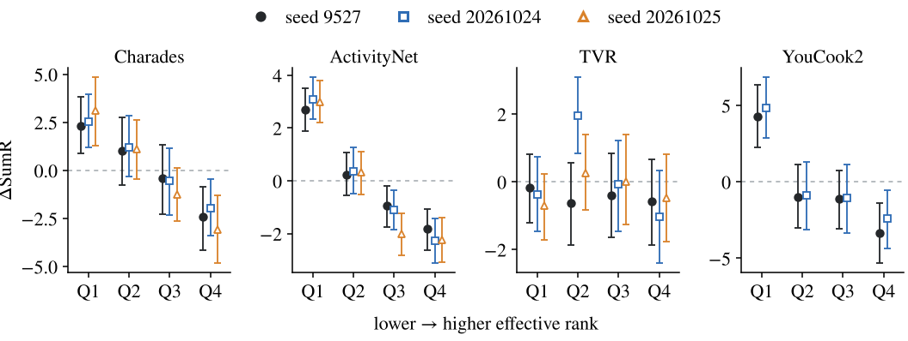
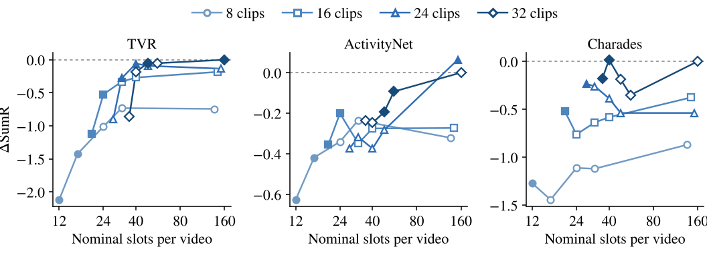
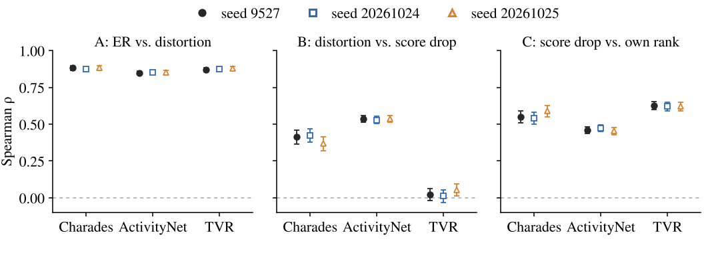
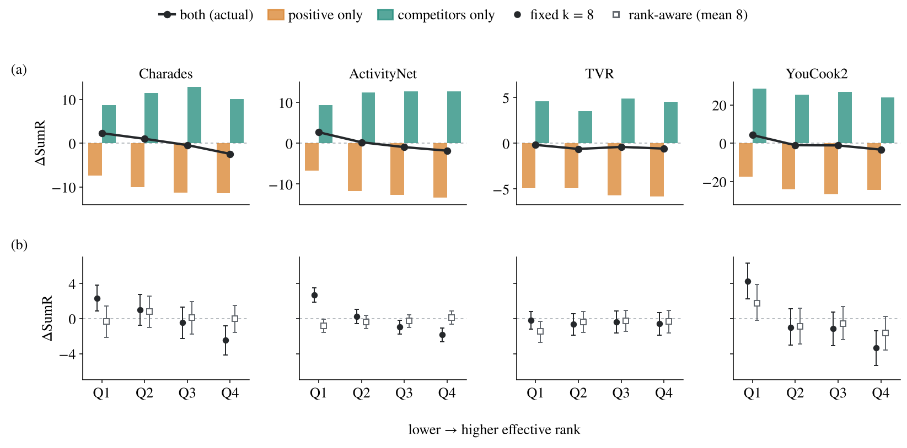

# Supplementary results

This page has the same content as the supplementary PDF, [Supplementary_Material.pdf](paper/supplement/Supplementary_Material.pdf). Sections 1–6 give robustness checks. Sections 7–10 give per-seed, per-dataset and per-model detail behind statements in Sections 4 and 5 of the paper. Section 11 repeats Figure 6 of the paper at a larger size. [figures.py](paper/supplement/figures.py) renders Figures S1–S4 from the result files.

All retrieval differences use SumR points. For compression contrasts, positive values favor the compressed index. Intervals in brackets are 95% intervals.

| Section | Contents |
|---|---|
| [1](#1-fusion-weights-for-the-retrained-controls) | Dual-Clip minus GMMFormerV2 under different fusion weights |
| [2](#2-per-recall-changes-under-frame-ward-8) | Per-recall changes for every dataset and seed |
| [3](#3-standard-euclidean-ward) | Ward linkage on Euclidean distances |
| [4](#4-excluding-padding-from-the-frame-maximum) | Padding and the frame maximum |
| [5](#5-selecting-checkpoints-on-a-separate-split) | Checkpoints selected on a held-out split |
| [6](#6-training-videos-as-retrieval-distractors) | Expanded retrieval corpora |
| [7](#7-effective-rank-quartiles-across-seeds) | All four effective-rank quartiles for every seed (Figure S1) |
| [8](#8-splitting-the-budget-per-dataset) | Budget split between branches for each dataset (Figure S2) |
| [9](#9-where-the-tvr-chain-breaks) | The three links of the TVR chain for every seed (Figure S3) |
| [10](#10-frame-compression-on-dreamprvr-and-hlformer) | Three compression rules on DreamPRVR and HLFormer |
| [11](#11-figure-6-at-a-larger-size) | Figure 6 of the paper at a larger size (Figure S4) |

## 1. Fusion weights for the retrained controls

The table reports Dual-Clip minus GMMFormerV2. Each architecture has three independently trained seeds. The last column gives equal weight to TVR, ActivityNet and Charades.

| GMMFormerV2 weights | Dual-Clip weights | TVR | ActivityNet | Charades | Mean |
|---|---|---:|---:|---:|---:|
| 0.7/0.3 | 0.5/0.5 | -0.97 | -0.69 | +0.72 | -0.31 |
| 0.7/0.3 | 0.7/0.3 | -1.94 | -1.10 | +0.34 | -0.90 |
| 0.5/0.5 | 0.5/0.5 | -2.09 | -1.39 | +1.05 | -0.81 |

The first row uses the prespecified weights for each architecture. On ActivityNet, the Welch intervals at matched weights are [-2.09, -0.12] at 0.7/0.3 and [-2.22, -0.55] at 0.5/0.5. At matched weights, Dual-Clip therefore falls detectably below GMMFormerV2 on ActivityNet, while its TVR and Charades intervals include zero. For scale, GMMFormerV2 leads the widened single branch of the paper's Table 2(a), which has no fusion weight, by 5.70 SumR on average at 0.7/0.3 and 6.20 at 0.5/0.5, and by 5.29 and 5.99 on ActivityNet. The matched-weight Dual-Clip deficits are 0.90 and 0.81 on average and 1.10 and 1.39 on ActivityNet, so Dual-Clip closes at least 84% of that gap on average and 76% on ActivityNet.

See `contrasts/K3_DualClip` in [prespecified weights](results/rq1_branch_controls/RESULTS.json) and `contrasts/<weights>/DualClip_minus_B0` in [matched weights](results/check_matched_weights/RESULTS.json). The widened single branch is under `macro_average/WideClipOnly` and `summary/WideClipOnly` in the prespecified-weight file.

## 2. Per-recall changes under frame Ward-8

For GMMFormerV2, the nine dataset–seed runs below compare frame Ward-8 with the uncompressed index at the same checkpoint. Recall changes are in percentage points.

| Dataset | Seed | Uncompressed R@1 | ΔR@1 | ΔR@5 | ΔR@10 | ΔR@100 | ΔSumR |
| --- | ---: | ---: | ---: | ---: | ---: | ---: | ---: |
| TVR | 9527 | 15.93 | -0.05 | -0.06 | -0.32 | -0.02 | -0.45 |
| TVR | 20261024 | 15.47 | +0.07 | -0.01 | +0.19 | -0.14 | +0.12 |
| TVR | 20261025 | 15.70 | -0.13 | -0.12 | +0.10 | -0.08 | -0.23 |
| ActivityNet | 9527 | 8.82 | +0.01 | +0.02 | +0.01 | -0.17 | -0.13 |
| ActivityNet | 20261024 | 9.01 | -0.21 | +0.02 | +0.02 | 0.00 | -0.17 |
| ActivityNet | 20261025 | 8.83 | -0.15 | -0.23 | -0.09 | +0.03 | -0.44 |
| Charades | 9527 | 2.34 | -0.11 | +0.27 | -0.30 | +0.13 | 0.00 |
| Charades | 20261024 | 2.66 | -0.05 | +0.08 | -0.11 | +0.30 | +0.22 |
| Charades | 20261025 | 2.07 | +0.22 | +0.11 | -0.05 | -0.43 | -0.16 |

The largest absolute change was 0.22 points at R@1 and 0.43 points across all four recall cutoffs. The latter was a decrease at R@100 on Charades for seed 20261025.

The uncompressed R@1 and the paired changes are stored under `runs/<dataset>/<seed>/uncompressed/R1` and `runs/<dataset>/<seed>/frameWard8/delta` in [the per-seed results](results/rq1_ward_seeds/RESULTS.json).

## 3. Standard Euclidean Ward

For frame Ward-8, changing the linkage input from cosine dissimilarities to Euclidean distances between normalized outputs changes fused SumR by at most 0.32 over five dataset–seed combinations. All five paired intervals contain zero. When both branches use eight representatives, the mean Euclidean-minus-cosine difference across the three primary datasets is -0.03. See `A_euclid/<dataset>/<seed>/8/diff` in [frame compression](results/check_euclidean_ward/RESULTS.json) and the [two-branch comparison](results/rq1_score_fusion/RESULTS.json).

The table gives the range of Euclidean Ward-8 changes across three seeds in the lowest and highest effective-rank quartiles. The two quartiles move in opposite directions on ActivityNet and Charades. Both point estimates are negative for each TVR seed.

| Dataset | Lowest quartile | Highest quartile |
|---|---:|---:|
| TVR | -0.84 to -0.22 | -1.50 to -0.66 |
| ActivityNet | +2.77 to +3.15 | -2.45 to -1.89 |
| Charades | +1.72 to +1.95 | -3.30 to -1.76 |

Per-seed point estimates and intervals are under `cells/*/groups/{Q1,Q4}/F`. [Euclidean Ward by quartile](results/check_euclidean_ward_rq2/RESULTS.json)

## 4. Excluding padding from the frame maximum

Excluding padded outputs leaves frame-only SumR, fused SumR and the fused Ward-8 loss in each effective-rank quartile unchanged on all four datasets. Individual fused retrieval ranks change for 198, 87, 1 and 3 queries on Charades, ActivityNet, TVR and YouCook2, respectively. The fields are `cases/<dataset>/padding/{metrics,ER_quartiles,changed_fusion_ranks}`. [Padding results](results/rq2_tvr_frame_branch/RESULTS.json)

## 5. Selecting checkpoints on a separate split

The selection split was held out from the training data. The table gives frame Ward-8 minus the uncompressed score on the official evaluation split, using clip/frame weights of 0.7/0.3.

| Dataset | Seed 9527 | Seed 20261024 |
|---|---:|---:|
| TVR | +0.23 | +0.19 |
| ActivityNet | +0.26 | +0.01 |
| Charades | +0.05 | -0.22 |

The six-checkpoint mean is +0.09. Each cell equals compressed minus uncompressed SumR in `ward8_selection_summary/*/dev_selected`. [Held-out selection results](results/check_heldout_selection/RESULTS.json)

## 6. Training videos as retrieval distractors

With the seed-9527 checkpoint and the same evaluation queries, each expanded corpus adds all available training videos as distractors. The differences compare frame Ward-8 with the uncompressed index in the same corpus.

| Dataset | Corpus size relative to native | Native difference | Expanded difference [95% interval] |
|---|---:|---:|---:|
| TVR | 9.00× | -0.45 | +0.12 [-0.43, +0.66] |
| ActivityNet | 3.04× | -0.13 | -0.20 [-0.56, +0.17] |
| Charades | 5.00× | 0.00 | 0.00 [-0.58, +0.61] |

The equal-dataset mean is -0.19 with native corpora and -0.03 with the added distractors. See `summary/frameWard8` and `contrasts/<dataset>/full/frameWard8/delta`. [Corpus expansion results](results/check_corpus_expansion/RESULTS.json)

## 7. Effective-rank quartiles across seeds

Figure 6 of the paper shows seed 9527. With eight frame representatives per video, the lowest effective-rank quartile detectably gains SumR and the highest quartile detectably loses SumR in all three GMMFormerV2 runs on Charades and ActivityNet and in both available runs on YouCook2. On TVR, the intervals for both extreme quartiles include zero in all three runs; one TVR run shows a detectable gain in the second quartile.

Videos are grouped by effective rank within each dataset and seed, and each query takes its relevant video's quartile. Intervals use 2,000 paired video-cluster bootstrap draws without adjustment across quartiles. For seed 9527, resampling within each quartile reproduces the intervals in Fig. 6(b) of the paper. For the other seeds, each draw resamples videos across the dataset and is shared by all four quartiles.

The table gives frame Ward-8 minus uncompressed fused SumR at the same checkpoint, with individual 95% intervals.

| Dataset | Seed | Q1 (lowest) | Q2 | Q3 | Q4 (highest) |
|---|---:|---:|---:|---:|---:|
| Charades | 9527 | +2.29 [+0.88, +3.83] | +1.01 [-0.79, +2.75] | -0.43 [-2.28, +1.32] | -2.43 [-4.16, -0.84] |
| Charades | 20261024 | +2.52 [+1.17, +3.95] | +1.21 [-0.32, +2.86] | -0.54 [-2.35, +1.16] | -1.96 [-3.41, -0.47] |
| Charades | 20261025 | +3.09 [+1.26, +4.84] | +1.11 [-0.44, +2.60] | -1.27 [-2.65, +0.11] | -3.10 [-4.84, -1.32] |
| ActivityNet | 9527 | +2.68 [+1.89, +3.49] | +0.23 [-0.55, +1.07] | -0.96 [-1.75, -0.19] | -1.82 [-2.62, -1.07] |
| ActivityNet | 20261024 | +3.09 [+2.32, +3.92] | +0.36 [-0.47, +1.28] | -1.10 [-1.86, -0.35] | -2.28 [-3.13, -1.41] |
| ActivityNet | 20261025 | +2.98 [+2.20, +3.78] | +0.31 [-0.52, +1.10] | -2.02 [-2.83, -1.22] | -2.24 [-3.08, -1.40] |
| TVR | 9527 | -0.18 [-1.21, +0.81] | -0.62 [-1.87, +0.55] | -0.40 [-1.65, +0.85] | -0.59 [-1.87, +0.66] |
| TVR | 20261024 | -0.37 [-1.46, +0.73] | +1.94 [+0.84, +3.08] | -0.07 [-1.46, +1.22] | -1.03 [-2.41, +0.33] |
| TVR | 20261025 | -0.70 [-1.73, +0.23] | +0.26 [-0.83, +1.40] | 0.00 [-1.27, +1.39] | -0.48 [-1.76, +0.82] |
| YouCook2 | 9527 | +4.26 [+2.24, +6.34] | -1.03 [-3.05, +1.12] | -1.15 [-3.08, +0.71] | -3.34 [-5.35, -1.40] |
| YouCook2 | 20261024 | +4.85 [+2.89, +6.84] | -0.91 [-3.13, +1.30] | -1.04 [-3.34, +1.14] | -2.43 [-4.39, -0.57] |

*Figure S1. The values of the table above with their 95% intervals.*

The next table gives the lowest-minus-highest contrast and the correlation between a video's effective rank and its loss, both computed with draws shared across quartiles. The contrast is one prespecified comparison per run. Its interval excludes zero in all six Charades and ActivityNet runs and in the YouCook2 run, and includes zero in all three TVR runs. ρ is the Spearman correlation between a video's effective rank and its loss (the mean rank increase of its relevant queries). Partial ρ controls for valid length. Dashes mark quantities that were not computed for that run.

| Dataset | Seed | Lowest - highest | ρ | Partial ρ |
|---|---:|---:|---:|---:|
| Charades | 9527 | +4.73 [+2.55, +6.94] | 0.40 [0.36, 0.45] | 0.36 [0.31, 0.41] |
| Charades | 20261024 | +4.48 [+2.48, +6.51] | 0.41 [0.36, 0.45] | 0.36 [0.31, 0.40] |
| Charades | 20261025 | +6.19 [+3.63, +8.63] | 0.40 [0.35, 0.44] | 0.33 [0.28, 0.38] |
| ActivityNet | 9527 | +4.51 [+3.41, +5.64] | 0.44 [0.42, 0.47] | 0.37 [0.34, 0.40] |
| ActivityNet | 20261024 | +5.37 [+4.20, +6.58] | 0.43 [0.40, 0.46] | 0.35 [0.32, 0.38] |
| ActivityNet | 20261025 | +5.22 [+4.03, +6.41] | 0.43 [0.41, 0.46] | 0.35 [0.32, 0.37] |
| TVR | 9527 | +0.40 [-1.31, +2.09] | 0.04 [0.00, 0.08] | - |
| TVR | 20261024 | +0.66 [-1.07, +2.51] | 0.03 [-0.01, 0.07] | - |
| TVR | 20261025 | -0.22 [-1.95, +1.34] | 0.06 [0.01, 0.10] | - |
| YouCook2 | 20261024 | +7.28 [+4.57, +10.02] | - | - |

Sources: `cells/*/own_quartiles` and `cells/*/correlations/fusion` in [additional-seed results](results/rq2_seeds/RESULTS.json), with YouCook2 seed 20261024 under `optional`. The seed-9527 quartile intervals are in [the group intervals](results/rq2_group_ci/RESULTS.json).

## 8. Splitting the budget per dataset

Figure 4 of the paper averages the three primary datasets. Figure S2 shows each dataset separately, averaged over three seeds. The values are `points/*/dataset_deltas` in [the budget frontier](results/budget_split/FRONTIER.json).

*Figure S2. Splitting a per-video vector budget between branches for GMMFormerV2, per dataset: mean SumR change over three seeds against the number of stored vectors. Lines connect splits with the same number of clip vectors; filled markers lie on the Pareto frontier of that dataset. The horizontal axis is logarithmic.*

## 9. Where the TVR chain breaks

Section 5 of the paper traces the TVR exception through three links. Figure S3 gives the video-level Spearman correlations for every seed. Link A relates effective rank (ER) to the distortion that summarization causes, that is, how far it moves a video's frame outputs. Link B relates that distortion to the drop in the frame scores of the video's relevant queries. Link C relates the score drop to the change in the video's own rank when only relevant videos are compressed. All three links are positive on Charades and ActivityNet. On TVR, links A and C hold, while link B stays between 0.01 and 0.05. The fields are `cells/*/correlations/{A,B,C}` in [the TVR chain results](results/rq2_tvr_chain/RESULTS.json).

*Figure S3. Video-level Spearman correlations for the three links, with 95% video bootstrap intervals, for three GMMFormerV2 seeds.*

## 10. Frame compression on DreamPRVR and HLFormer

Section 4 of the paper states that uniform pooling and k-means also lose more than Ward-8 on DreamPRVR and HLFormer. Ward-8 has the highest fused SumR point estimate of the three rules in each of the six model–dataset comparisons; the smallest gap is 0.02 SumR, between Ward-8 and k-means on TVR for DreamPRVR. As preregistered, the paper orders the rules by the equal-weight mean over the three datasets. The intervals compare each rule with the uncompressed index, not the rules with one another, and each comparison uses one checkpoint per model and dataset, so the table does not measure variation across training seeds.

DreamPRVR uses our seed-0 checkpoints, with clip/frame weights of 0.5/0.5 on TVR and 0.6/0.4 on ActivityNet and Charades. HLFormer uses the released checkpoints with weights of 0.7/0.3. Each rule summarizes the frame branch into at most eight vectors per video; the clip branch is unchanged. All three rules share 2,000 paired video-cluster bootstrap draws within each comparison. Means weight the three datasets equally.

The table gives the change in fused SumR relative to the uncompressed index at the same checkpoint.

| Model | Dataset | Ward-8 | Uniform pooling | Euclidean k-means |
|---|---|---:|---:|---:|
| DreamPRVR | TVR | -1.07 [-1.88, -0.29] | -1.94 [-2.86, -1.04] | -1.09 [-1.91, -0.27] |
| DreamPRVR | ActivityNet | +0.29 [-0.21, +0.82] | -0.65 [-1.23, -0.07] | +0.07 [-0.42, +0.54] |
| DreamPRVR | Charades | -0.51 [-1.71, +0.68] | -1.16 [-2.61, +0.32] | -0.97 [-2.12, +0.14] |
| DreamPRVR | Mean | -0.43 | -1.25 | -0.66 |
| HLFormer | TVR | -0.06 [-0.65, +0.56] | -0.49 [-1.18, +0.25] | -0.12 [-0.73, +0.50] |
| HLFormer | ActivityNet | -0.03 [-0.46, +0.39] | -0.43 [-0.93, +0.09] | -0.12 [-0.53, +0.31] |
| HLFormer | Charades | -0.13 [-1.11, +0.77] | -0.30 [-1.39, +0.94] | -0.51 [-1.48, +0.47] |
| HLFormer | Mean | -0.08 | -0.40 | -0.25 |

The values are under `cells` and `summary` in [the compressor comparison](results/check_crossmodel_compressors/RESULTS.json). The k-means settings are in [KMEANS.json](configs/check_crossmodel_compressors/KMEANS.json).

## 11. Figure 6 at a larger size

*Figure S4. Figure 6 of the paper redrawn at a larger size from the same data and plotting code; the content is unchanged (GMMFormerV2, seed 9527, frame Ward-8). (a) Change when only the relevant video is compressed (positive only), when only its competitors are compressed (competitors only), and when both are (line). (b) A fixed budget of eight representatives versus effective-rank allocation with a mean of eight, with video-cluster bootstrap intervals.*
